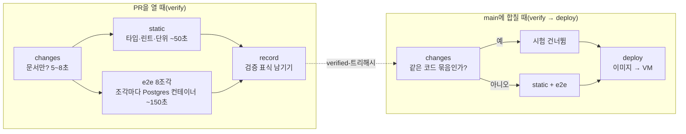

# CI/CD 개선 기록

모도리의 CI/CD(GitHub Actions)를 **측정 → 병목 → 실험 → 채택/기각**으로 줄여 온 과정. 포트폴리오·면접에서 근거로 쓰려고 숫자와
기각한 길까지 남긴다. 결정의 상황·선택지·대가는 `docs/decisions.md`의 두 항목("CI를 쪼개고 시험 DB를 러너 안으로 옮긴다",
"CI/CD를 측정으로 다시 짠다")에 있다.

## 한눈에

| | 처음 | 2026-11-19 이후 | 2026-11-23 이후 |
|---|---|---|---|
| PR 검증 | 67분(E2E 358개를 한 줄로) | 352초(중앙값, 최근 20회) | **190초**(캐시 적중, 1회 실측) |
| main 검증 | 같음 | 360초 | 같은 코드 묶음이면 수 초(**미확인**: 병합 뒤 실측) |
| 배포 | | 116초 | 같음(문서만 바뀌면 건너뜀, **미확인**) |
| PR을 열고 운영에 뜨기까지 | 약 2시간 15분(추정: PR 67분 + main 67분 + 배포) | 약 14분(352 + 360 + 116초) | 약 5분(**예상**, main 쪽 실측 뒤 확정) |
| 문서만 바꾼 PR | 위와 같음 | 위와 같음 | 시험·배포를 건너뜀(**미확인**) |

표본이 작다. 러너마다 편차가 커서 같은 코드가 조각 하나에서 114초~226초로 나온 적이 있다. "중앙값 N회"와 "1회 실측"을 구분해 적었다.

## 파이프라인(2026-11-23 이후)

- `changes`: 문서(`docs/`, `.md`)만 바뀌었으면 건너뛴다. main에서는 합쳐진 결과의 git tree 해시로 "PR이 이미 통과시킨 같은 코드인가"를 본다.
- `e2e`: 시험 파일 94개를 **실측 시간 기준**으로 8조각에 고르게 나눈다. 조각마다 운영과 같은 `postgres:18-alpine`을 러너 안에 띄운다.
- `record`: PR 검증이 끝까지 통과해야만 `verified-<tree 해시>` 표식(아티팩트, 7일)을 남긴다.
- `warm`: main에서 캐시를 채운다(PR은 자기 브랜치와 main의 캐시만 읽는다).
- `deploy`: 같은 커밋의 `verify`가 성공해야 한다는 규칙(2026-09-29)은 그대로. 마지막 배포 뒤로 문서만 바뀌었으면 건너뛴다.

## 어떻게 찾았나: 추측하지 않고 쟀다

1. **단계별 시간**을 Actions API에서 뽑았다(작업·단계마다 시작·끝). 느낌이 아니라 표로 봤다.
2. 변수를 하나씩만 바꾸는 **실험 PR(#300, 병합하지 않고 닫음)**로 같은 코드·같은 조각에서 비교했다.
3. 시험 파일별 시간을 JSON 리포터로 뽑아(`scripts/e2e-timing.mjs`) 균형 배치의 입력(가중치)으로 썼다.

찾은 병목:

| 병목 | 실측 | 해결 |
|---|---|---|
| 조각 불균형 | 조각 4개가 87/111/78/91개로 갈려 시험 구간 107~245초. 가장 느린 조각이 전체를 정함 | 파일별 실측 시간으로 8조각 균형 배치(91~102초) |
| 작업마다 반복되는 설치 | `npm ci` 45~74초 × 작업 5개 | `node_modules` 캐시(복원 3초) |
| 같은 시험을 두 번 | PR 352초 + main 360초 | 같은 tree 해시면 main 건너뛰기 |
| 의미 없는 검증·배포 | 문서만 바꾼 변경도 약 14분 | 문서만 바뀌면 시험·배포 건너뛰기 |
| (남은 것) | Playwright 글꼴 설치 7~71초 편차, VM으로 보내 띄우기 약 51초 | 아래 "다음 후보" |

## 실험과 결과(채택과 기각)

| 시도 | 결과 | 판단 |
|---|---|---|
| 워커 1·2·3 (4조각) | 최악 조각 시험 구간 245 / 148 / 128초. 불안정 시험 0 / 2 / 2건 | **기각**. 시험 사이의 경쟁이 드러나고, 고치려면 시험을 바꿔야 한다 |
| 균형 배치 6조각 / 8조각 (워커 1) | 시험 구간 112~135초 / 91~102초 | **채택**(8조각) |
| `node_modules` 캐시 | 설치 74초 → 15초 | **채택**. 단, 캐시 안의 Prisma 클라이언트가 낡을 수 있어 적중해도 `prisma generate`를 다시 돌린다 |
| Docker buildx + GHA 캐시 | 코드만 바꾼 재빌드 67초 = 캐시 없는 빌드 67초 | **기각**. 캐시를 받는 시간이 다시 설치하는 시간과 비슷 |
| `playwright --with-deps` 빼기 | 브라우저는 뜸. 빠지는 9개 패키지가 전부 글꼴(한글·일본어 포함) | **기각**. 한·영·일 화면의 글자 폭이 달라져 시험 환경이 바뀐다 |
| main 재검증 없애기: 브랜치 보호에 맡기기 | 설정과 사람의 규율에 기댐 | **기각**. 내용이 같은지를 스스로 확인하는 쪽(tree 해시)을 골랐다 |

기각한 것도 숫자로 남기는 이유: "해 봤더니 효과가 없었다"가 다음 사람이 같은 길을 다시 가지 않게 한다.

## 안전장치: 건너뛰기가 틀리면 검증 안 된 코드가 나간다

검증을 건너뛰는 것은 속도를 위해 안전을 거는 일이라 틀렸을 때의 손해를 "시간 낭비까지"로 묶었다.

- **확신이 없으면 전부 돌린다.** API 오류, 기준 커밋 못 가져옴, PR의 부모가 둘이 아님 등 어느 단계가 실패해도 건너뛰지 않는다(`scripts/ci-changes.mjs`).
- **내용이 같다는 증거를 쓴다.** 커밋 번호나 PR 번호가 아니라 git tree 해시(파일 내용의 해시)가 같을 때만 재사용한다. 기준 브랜치가 그 사이 움직였으면 해시가 달라 전부 돌린다.
- **표식의 이름만 믿지 않는다.** 표식을 남긴 실행이 이 저장소의 `verify`를 PR로 돌려 **성공**했는지를 실행 기록에서 다시 본다.
- **전제를 시험으로 고정했다.** "문서만 바뀌면 시험 결과가 안 바뀐다"는 시험·앱이 문서를 읽지 않아서 성립한다.
  `tests/unit/ci-docs-assumption.test.ts`가 그 가정을 지킨다(임시 파일로 위반을 만들어 실제로 잡히는 것을 확인했다).
- **판정 규칙도 시험한다.** `tests/unit/ci-changes.test.ts`가 문서로 볼 것 6가지와 보면 안 될 것 14가지(`docs-site/`, `notes.md.ts`, `package.json` 등)를 확인한다.
- **조각 나누기도 시험한다.** `tests/unit/e2e-shard.test.ts`가 모든 시험 파일이 정확히 한 조각에 들어가는지, 새 파일도 빠지지 않는지 확인한다.
  조각마다 따로 계산하는 방식이라, 이 시험이 없으면 어떤 파일이 한 번도 안 돌아도 CI가 초록색이다.
- 시험 코드와 시험 환경은 바꾸지 않았다(규칙: 테스트를 고쳐서 통과시키지 않는다).

## 한계

- 숫자 표본이 작고 러너 편차가 크다. "미확인"으로 표시한 것은 병합 뒤 main 실행으로 재야 한다.
- main에서 재검증이 사라져, 같은 코드가 날짜·러너 이미지·외부 서비스 변화로 깨지는 것은 다음 PR이 잡는다(11-22에 연도 경계 날짜 시험이 그렇게 깨졌다).
- 가중치 파일은 시간이 지나면 낡는다. 낡아도 시험이 빠지지는 않고 균형만 덜 맞는다.
- 새 락 파일을 가진 PR의 첫 실행은 캐시가 없어 느리다(실측 257초).

## 다음 후보(측정으로 가치가 확인된 것만)

1. **이미지 전송 줄이기**: 배포 116초 중 "VM으로 보내 띄우기"가 약 51초(전송과 VM 쪽 적재·마이그레이션·재기동을 나눠 재지는 못했다).
   이미지는 704MB(gzip 171MB)이고 매번 바뀌는 것은 앱 층 131MB뿐이다. 레지스트리로 바뀐 층만 보내면 줄 가능성이 있지만
   VM의 `deploy.sh`를 바꿔야 해서 운영자의 작업이 필요하고, 줄어드는 양은 아직 모른다.
2. **글꼴 설치의 꼬리**: 가장 느린 조각이 전체를 정하는데 Playwright 글꼴 설치가 7~71초로 들쭉날쭉하다. 글꼴 `.deb` 캐시가 후보지만 러너 이미지 버전에 묶인다.
3. **워커 2**: 4조각 기준으로 가장 느린 조각의 시험 구간이 245 → 148초였다. 8조각 균형 배치와 겹쳤을 때의 이득은 재 보지 않았다.
   불안정한 시험을 먼저 고쳐야 한다(앱 URL 열기 시험의 준비 경쟁 등). 시험을 바꾸는 일이라 승인이 필요하다.

## 운영 메모

- 가중치 갱신: `gh run view <verify 실행 번호> --log | node scripts/e2e-shard.mjs --update`(실행 **전체** 로그. 조각 하나만 넣으면 경고가 나온다).
  로그의 `TIMING` 줄은 각 조각의 "시간 요약" 단계(`scripts/e2e-timing.mjs`)가 남긴다. 작업 요약에는 가장 느린 파일 10개와 불안정 시험 수가 나온다.
- 조각 수를 바꾸려면 `verify.yml`의 `matrix.shard`와 `scripts/e2e-shard.mjs ... 8`의 8을 같이 바꾼다.
- 건너뛰기를 끄고 싶으면 `scripts/ci-changes.mjs verify`가 항상 `skip=false`를 쓰게 하면 된다(나머지 구조는 그대로 돈다).
